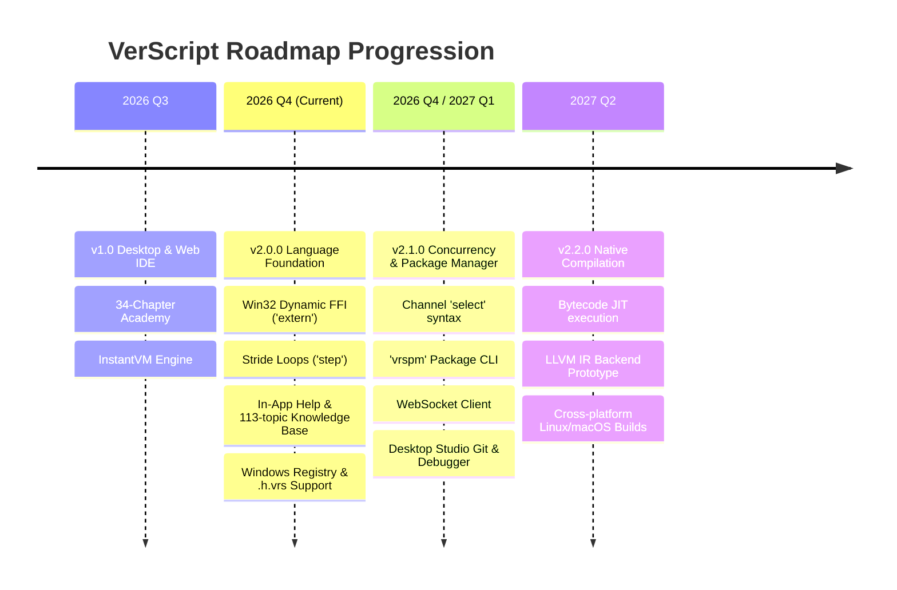

# VerScript Ecosystem Technical Roadmap (2026–2027)

This document outlines the strategic priorities, release targets, and architectural milestones for the VerScript programming language, official runtimes, and developer tooling.

---

## 🗺️ Roadmap Architecture

---

## 🎯 Phase Milestones

### Phase 1: v2.0.0 — Universal Language Foundation (Status: Shipped ✅)
- [x] **Core Language**: Complete standard library (21 modules), custom error handlers with suppression tiers, matrix-vector mathematics, pipeline `|>` operator.
- [x] **Language Features**:
  - `step` keyword for loop strides: `for i in 0 .. 10 step 2:`
  - `extern` keyword for dynamic Win32 FFI: `extern "kernel32.dll" GetCurrentProcessId()`
- [x] **Binary Self-Updater**: Built-in `verscript update` command checking GitHub releases.
- [x] **Universal File System**: First-class support for `*.vrs` (scripts), `*.lib.vrs` (modules), and `*.h.vrs` (headers).
- [x] **Windows Registry**: Auto-registration script for file icons and context menu execution.
- [x] **Brand Redesign**: New authentic overlapping ribbon logo across all platforms.
- [x] **Documentation & Help**: Dedicated `VerScript/help` repository and live Help Center at `verscript.github.io/help`.

---

### Phase 2: v2.1.0 — Concurrency, Package Ecosystem & Tooling (Status: In Progress ⚡)
**Target: Q4 2026 / Q1 2027**

#### Core Language & Runtime
- [ ] **Channel `select` Syntax**: Non-blocking channel multiplexing across multiple concurrent channels.
- [ ] **Package Manager CLI (`vrspm`)**:
  - Automated package dependency resolution (`vrspm.json`).
  - Search, install, update, and publish community libraries from GitHub.
- [ ] **Standard Library Additions**:
  - `net` library: Add client WebSocket support (`ws.connect("wss://...")`).
  - `crypto` library: SHA-256, HMAC, and AES encryption helpers.

#### Desktop Studio (v1.4.0)
- [ ] **Git Version Control Panel**: Visual stage, commit, diff, and push from inside the IDE.
- [ ] **Visual Breakpoint Debugger**: Line breakpoints, call-stack inspection, and variable watch lists.
- [ ] **Multi-Tab Terminal**: Native terminal drawer supporting PowerShell and bash.

#### Android Studio Mobile (v1.1.0)
- [ ] **Symbol Accessory Toolbar**: Quick touch access to special symbols (`:`, `|>`, `::`, `?`, `!`, `&`, `[`, `]`).
- [ ] **Native Termux Bridge**: Execute native ARM64 VerScript binary on-device via Termux.
- [ ] **Export & Sharing**: Native Android Share Sheet integration for `.vrs` files.

#### Web & Academy (v2.1.0)
- [ ] **Interactive Project Board**: Live Kanban roadmap tracking all issues and milestones at `verscript.github.io/project`.
- [ ] **Code Snippet Sharing**: Compressed URL fragment sharing for instant snippet loading.
- [ ] **Global Unified Search**: Instant fuzzy search across Academy chapters, Help Center, and packages.

---

### Phase 3: v2.2.0 — Optimization & JIT Compiler (Status: Planned 📋)
**Target: Q2 2027**
- [ ] **Bytecode JIT Execution**: Dynamic translation of frequently executed bytecode loops to native machine instructions.
- [ ] **LLVM IR Generation Backend**: Prototype native ahead-of-time (AOT) compiler target producing standalone optimized ELF/PE binaries.
- [ ] **Cross-Platform Parity**: Automated continuous integration producing official macOS (Apple Silicon / Intel) and Linux x86_64/aarch64 binaries.

---

## 📈 Tracking & Management
All issues and milestones are actively updated and visible on our [Interactive Project Board](https://verscript.github.io/project).
