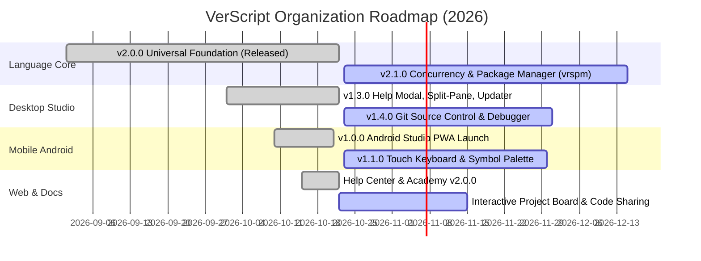

<div align="center">


# VerScript Organization
### Modern, Strongly Typed, Declarative Programming Language & Ecosystem

[](https://verscript.github.io)
[](https://verscript.github.io/docs/)
[-BD00FF?style=for-the-badge&logo=gitbook&logoColor=white)](https://verscript.github.io/help/)
[-0077FE?style=for-the-badge&logo=github&logoColor=white)](https://verscript.github.io/project/)
[](https://github.com/VerScript/VerScript/releases/tag/v2.0.0)

<br/>

**VerScript** is a modern programming language designed for precision, expressive pipeline composition, and zero-friction execution. It features first-class reactive channels, matrix-vector mathematics, dynamic foreign function interfaces (FFI), declarative data constraints, and a unified toolchain across desktop, mobile, and web.

</div>

---

## 🏛️ Ecosystem Overview & Project Directory

The VerScript organization maintains eight integrated repositories across language design, runtimes, developer tooling, documentation, and cloud infrastructure:

| Repository | Scope & Purpose | Active Version | Build & Health | Links |
| :--- | :--- | :--- | :--- | :--- |
| **[`VerScript/VerScript`](https://github.com/VerScript/VerScript)** | Core native C compiler, VM, AST lexer/parser (151 keywords), Win32 dynamic FFI, and 21 standard libraries. | `v2.0.0` |  | [Releases](https://github.com/VerScript/VerScript/releases) • [Source](https://github.com/VerScript/VerScript) |
| **[`VerScript/verscript-studio-desktop`](https://github.com/VerScript/verscript-studio-desktop)** | Standalone desktop IDE built on Electron, Monaco editor, split-view layout, and embedded Help Center. | `v1.3.0` |  | [Releases](https://github.com/VerScript/verscript-studio-desktop/releases) • [Source](https://github.com/VerScript/verscript-studio-desktop) |
| **[`VerScript/verscript-studio-android`](https://github.com/VerScript/verscript-studio-android)** | Standalone mobile IDE for Android with touch-first explorer, InstantVM engine, and PWA capabilities. | `v1.0.0` |  | [Live Mobile App](https://verscript.github.io/mobile) • [Releases](https://github.com/VerScript/verscript-studio-android/releases) |
| **[`VerScript/VerScript.github.io`](https://github.com/VerScript/VerScript.github.io)** | Official website, 74-chapter documentation Academy, interactive REPL playground, and Project Kanban. | `v2.0.0` |  | [Website](https://verscript.github.io) • [Source](https://github.com/VerScript/VerScript.github.io) |
| **[`VerScript/help`](https://github.com/VerScript/help)** | Official language reference, multi-functionality keyword encyclopedia (all 151 keywords), standard library API docs, and error remedies (247 topics). | `v2.0.0` |  | [Help Center](https://verscript.github.io/help) • [Releases](https://github.com/VerScript/help/releases) |
| **[`VerScript/IDE`](https://github.com/VerScript/IDE)** | Browser-based Web IDE featuring InstantVM client-side execution, virtual file tree, and code share. | `v1.0.0` |  | [Web IDE](https://verscript.github.io/ide) • [Source](https://github.com/VerScript/IDE) |
| **[`VerScript/polyserver`](https://github.com/VerScript/polyserver)** | Unified Node.js backend proxy and multi-protocol service orchestrator. | `v1.0.0` |  | [Source](https://github.com/VerScript/polyserver) |
| **[`VerScript/VS-Sharp`](https://github.com/VerScript/VS-Sharp)** | AI assistant (LLM) and pair-programmer tightly integrated into VerScript Studio. | `v0.5.0` |  | [Source](https://github.com/VerScript/VS-Sharp) |

---

## 📊 Live Project Tracking & Roadmap

We actively track milestones, epics, bug fixes, and feature requests across all repositories.

👉 **View the Live Interactive Project Board**: **[https://verscript.github.io/project](https://verscript.github.io/project)**

### Active Milestones



---

## 🛠️ Key Language Pillars & Quickstart

```verscript
# 1. Foreign Function Interface (Dynamic Win32 Call)
extern "kernel32.dll" GetCurrentProcessId()
pid : GetCurrentProcessId()
display "Process ID: " + pid ?color=#00FFCC

# 2. Pipeline Operators & Range Iteration with 'step'
numbers : [1, 2, 3, 4, 5, 6, 7, 8, 9, 10]
for i in 0 .. 10 step 2:
    display "Step: " + i

# 3. Native Matrix Mathematics
matA : [[1, 2], [3, 4]]
matB : [[5, 6], [7, 8]]
matC : matA * matB
display "Matrix Product: " + matC
```

Install the native toolchain in PowerShell:
```powershell
# Clone and install VerScript runtime into %LOCALAPPDATA%\VerScript
git clone https://github.com/VerScript/VerScript.git
cd VerScript
.\tooling\installer\install.ps1
```

To update an existing installation to the latest version at any time:
```powershell
verscript update
```

---

## 🤝 Contributing & Community
- **Issue Tracker**: Check out open issues labeled [`status:todo`](https://github.com/issues?q=is%3Aopen+is%3Aissue+user%3AVerScript+label%3Astatus%3Atodo) or [`priority:high`](https://github.com/issues?q=is%3Aopen+is%3Aissue+user%3AVerScript+label%3Apriority%3Ahigh).
- **Contributing Guide**: Read our [Contributing Guidelines](https://github.com/VerScript/.github/blob/main/CONTRIBUTING.md).
- **Security Policy**: Read our [Security Policy](https://github.com/VerScript/.github/blob/main/SECURITY.md).
- **Code of Conduct**: We adhere to the [Contributor Covenant](https://github.com/VerScript/.github/blob/main/CODE_OF_CONDUCT.md).

---

<div align="center">
<sub>Maintained with ❤️ by the VerScript Core Team. Licensed under the MIT License.</sub>
</div>
